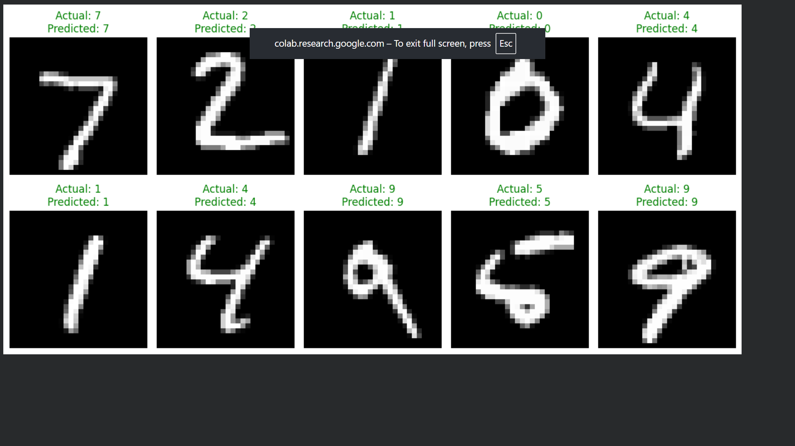

# Handwritten Digit Recognition Using PyTorch

## Overview
A beginner deep-learning project that uses a feedforward neural network built with PyTorch to recognise handwritten digits (0–9) from the MNIST dataset.

## Project Objective
The objective is to train a neural network to classify handwritten digit images and evaluate its performance on unseen data.

## Technologies Used
- Python
- PyTorch
- Torchvision
- Matplotlib
- MNIST Dataset

## Model Architecture
The neural network consists of:
- Input layer: 784 features (28 × 28 pixels)
- Hidden layer 1: 128 neurons with ReLU activation
- Hidden layer 2: 64 neurons with ReLU activation
- Output layer: 10 classes (digits 0–9)

## Training Configuration
- Optimiser: Adam
- Learning rate: 0.001
- Loss function: CrossEntropyLoss
- Training epochs: 5
- Training images: 60,000
- Testing images: 10,000

## Results

**Test Accuracy: 97.58%**

- Correct predictions: 9,758
- Incorrect predictions: 242

The model was evaluated using the MNIST test dataset.

## Project Files
- `Handwritten_Digit_Recognition.ipynb` — notebook containing the implementation and training process.
- `handwritten_digit_model.pth` — saved trained model parameters.

## How to Run
1. Open the notebook using Google Colab or Jupyter Notebook.
2. Install PyTorch and Torchvision if they are not already installed.
3. Run the notebook cells to load the dataset, build the model, train it and evaluate its performance.

## Learning Outcomes
- Introduction to artificial neural networks.
- Practical experience with PyTorch.
- Understanding of model training and backpropagation.
- Model evaluation using classification accuracy.

## Prediction Results

## Dataset
[MNIST Handwritten Digit Database](http://yann.lecun.com/exdb/mnist/)

## Author
**Abdulsamad Bashir**
